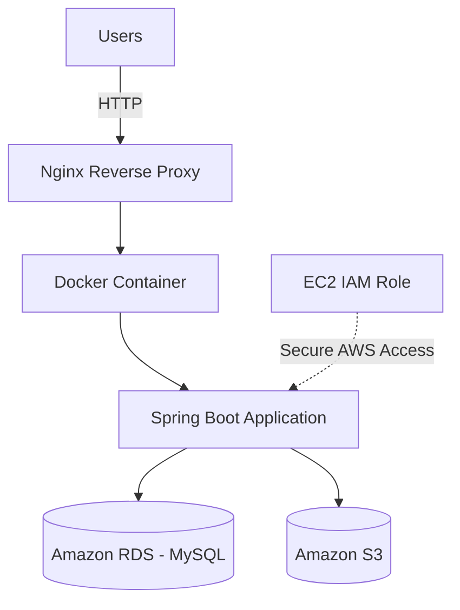

# ☁️ Cloud File Manager

A cloud-based file management application inspired by **Google Drive**, built using Java, Spring Boot and AWS.

The application enables users to securely upload, manage, search, download and share files using time-limited presigned URLs.

## ✨ Key Features

- Secure user registration and authentication using Spring Security and BCrypt.
- Role-based access control with USER and ADMIN roles.
- File upload, download, search and pagination.
- Secure file sharing through 10-minute presigned URLs.
- User-specific file isolation.
- Admin dashboard for monitoring registered users and uploaded files.
- Private Amazon S3 storage with UUID-based object keys.
- File metadata management using MySQL.

## 🛠️ Technology Stack

| Category | Technologies |
|---|---|
| Backend | Java 21, Spring Boot 4.0.9 |
| Frontend | Thymeleaf, Tailwind CSS |
| Security | Spring Security, BCrypt |
| Database | MySQL, Amazon RDS |
| Cloud Storage | Amazon S3 |
| Cloud Infrastructure | Amazon EC2, AWS IAM |
| Containerization | Docker, Docker Compose |
| Web Server | Nginx |
| API Documentation | Swagger / OpenAPI |
| Build Tool | Maven |

## ☁️ AWS Architecture

The application uses multiple AWS services working together:

- **Amazon EC2:** Hosts the containerized Spring Boot application.
- **Amazon RDS:** Stores user accounts and file metadata.
- **Amazon S3:** Provides secure and scalable file storage.
- **AWS IAM:** Enables secure S3 access through EC2 IAM roles.
- **Security Groups:** Control network access between AWS resources.

### Architecture Diagram

## 🚀 Deployment Highlights

- Deployed on Amazon EC2 using Amazon Linux 2023.
- Containerized using Docker and Docker Compose.
- Configured Nginx as a reverse proxy.
- Integrated Amazon RDS and Amazon S3.
- Configured EC2 IAM roles for secure AWS service access.
- Implemented network access control using security groups.

## 💡 Key Learnings

Hands-on experience with AWS infrastructure, IAM permissions, cloud storage, managed databases, Docker-based deployment, Linux administration, networking and reverse proxy configuration.

## 👨‍💻 Author

**Manan Pandya**

GitHub: [pandya-manan](https://github.com/pandya-manan)

**Repository:** [Cloud File Manager](https://github.com/pandya-manan/cloud-file-manager)

---

⭐ Feedback and suggestions are welcome!
